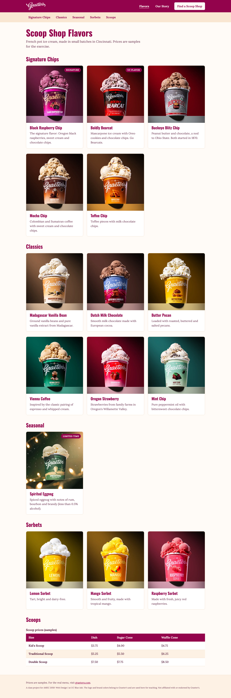

# 🍦 Graeter's Scoop Shop

## 🎯 Overview

The Graeter's Scoop Shop site is already built and styled. Your job is the details that make it feel finished:
a category nav that stays put while you scroll, badges pinned to the corners of flavor cards, hover and keyboard
focus states, a striped price table and decorative quotation marks. You'll practice **positioning**, **z-index**,
**pseudo-classes** and **pseudo-elements**, all in a single stylesheet: `css/details.css`.

## 📋 Requirements

Write all of your CSS in `css/details.css`. Don't edit `css/base.css`.

- [ ] **Sticky category nav:** the flavor category nav sticks to the top of the window as you scroll and stays
  above the content that scrolls under it.
- [ ] **Card badges:** add a `` to three cards in `index.html`, then pin each badge to the
  top-right corner of its card with positioning. The badge sits above the flavor photo.
    - Black Raspberry Chip: `Signature`
    - Boldly Bearcat: `UC Flavor`
    - Spirited Eggnog: `Limited Time`
- [ ] **Hover and focus:** the category nav links, the main nav links and the buttons each have a `:hover` style
  and a matching `:focus-visible` style. Links have a visible focus outline.
- [ ] **Striped table:** the rows of the scoop price table alternate colors using `:nth-child()`.
- [ ] **Quotation marks:** the blockquote on the Our Story page has decorative opening and closing quotation marks,
  added with `::before` and `::after`.
- [ ] **Colors come from variables:** use the color variables in `css/base.css` (for example,
  `var(--color-primary)`) instead of typing hex values.

## 🖼️ Example Output

This is the finished Flavors page at desktop width. Yours should look very close to it.

What a screenshot won't show:

- Scroll down `index.html`. The category nav stays pinned to the top of the window, and the cards scroll under it.
- Press <kbd>Tab</kbd> through the page. Every link and button shows where focus is, and nav links and buttons look
  the same on focus as they do on hover.

## 📂 Starter Files

| File / Folder     | Purpose                                                                 |
|-------------------|-------------------------------------------------------------------------|
| `index.html`      | Flavors page: category nav, flavor cards and the price table            |
| `about.html`      | Our Story page with the blockquote                                      |
| `css/base.css`    | Provided styles and color variables. **Don't edit this file.**          |
| `css/details.css` | **Your work goes here.** The comment at the top lists each task         |
| `images/`         | Logo, flavor photos and the About page portrait                         |

## 🧮 Grading

| Criteria                 | Full credit                                                                                                    | Partial credit                                                                          | No credit                         | Points |
|--------------------------|----------------------------------------------------------------------------------------------------------------|-----------------------------------------------------------------------------------------|-----------------------------------|--------|
| Sticky category nav      | Nav sticks to the top while scrolling and stays above all content that scrolls under it                       | Nav sticks, but some content shows on top of it                                         | Nav doesn't stick                 | 2      |
| Card badges              | All three badges are added in the HTML and pinned to their card's top-right corner, above the photo           | Badges are positioned but sit in the wrong place, behind the photo, or one is missing   | Badges missing or not positioned  | 3      |
| Hover and focus states   | Category nav, main nav and buttons have matching `:hover` and `:focus-visible` styles; links show a focus outline | Hover styles work, but some focus styles are missing or don't match                  | No hover or focus styles          | 3      |
| Striped table            | Price table rows alternate colors using `:nth-child()`                                                         | Rows are striped another way, or the header row is striped too                          | No stripes                        | 2      |
| Quotation marks          | Opening and closing marks are added with `::before` and `::after` and are clearly decorative                  | Only one mark, or the marks are typed into the HTML                                     | No quotation marks                | 2      |
| Code quality             | All CSS is in `details.css`, colors use the variables, and the code is formatted and easy to read             | Some hex values instead of variables, or `base.css` was edited                          | Styles are missing or broken      | 2      |
| Submission               | Site is live on GitHub Pages, and the pull request is open with every template section filled in              | Site or pull request is incomplete                                                      | Not submitted                     | 1      |
| **Total**                |                                                                                                                |                                                                                         |                                   | **15** |

## 📚 Resources

- [MDN: `position`](https://developer.mozilla.org/en-US/docs/Web/CSS/position)
- [MDN: `z-index`](https://developer.mozilla.org/en-US/docs/Web/CSS/z-index)
- [MDN: `:focus-visible`](https://developer.mozilla.org/en-US/docs/Web/CSS/:focus-visible)
- [MDN: `:nth-child()`](https://developer.mozilla.org/en-US/docs/Web/CSS/:nth-child)
- [MDN: `::before`](https://developer.mozilla.org/en-US/docs/Web/CSS/::before) and
  [`::after`](https://developer.mozilla.org/en-US/docs/Web/CSS/::after)

The AI policy and submission instructions are in the [README](../README.md).

## 🆘 Getting Help

Ask during class or office hours, or post on the Canvas discussion board.

---

The AI policy and submission instructions are in the [README](../README.md).
